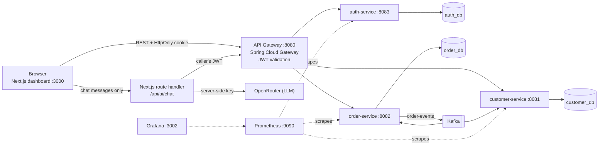
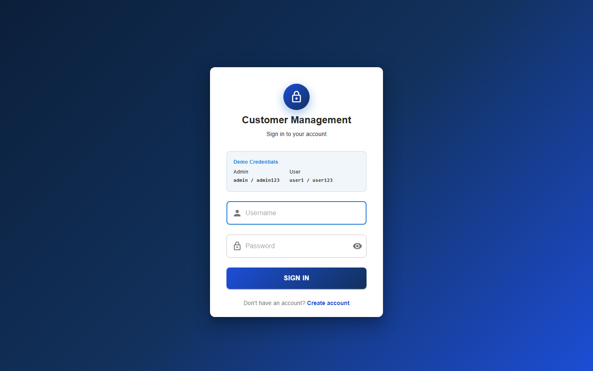
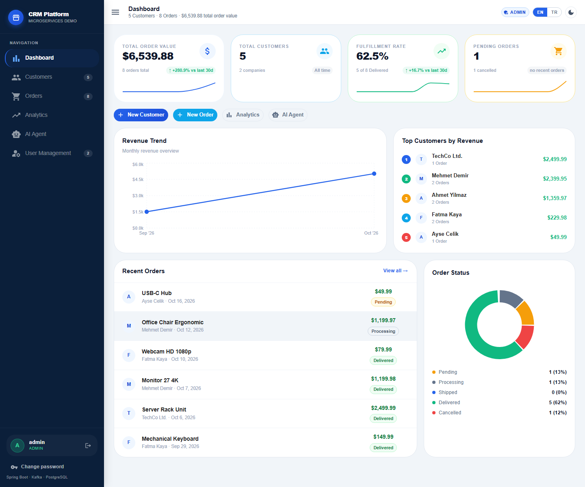
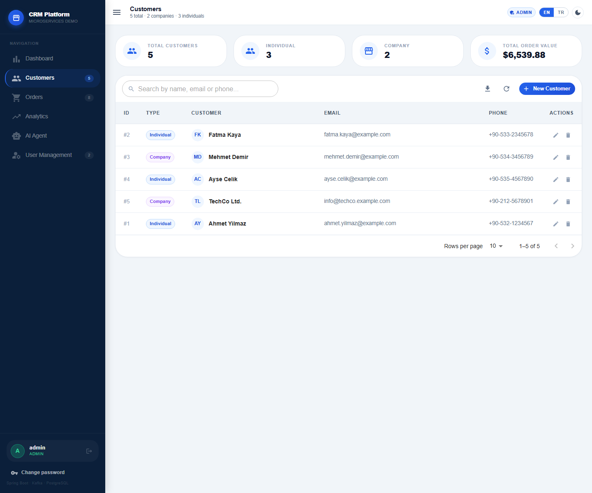
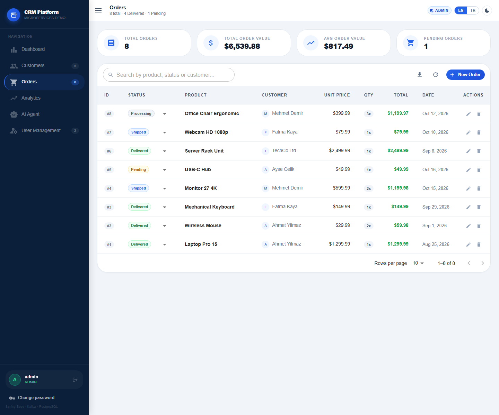
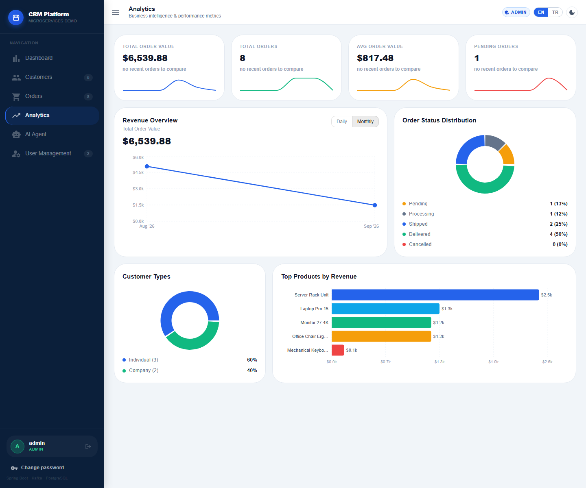
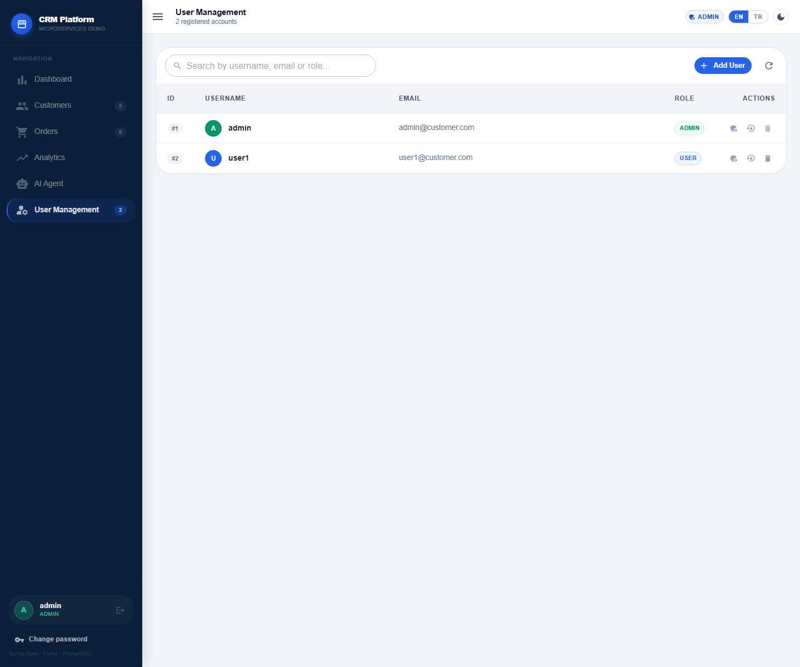

# Customer Management System

[](https://github.com/eucardeveloper/customer-management/actions/workflows/ci.yml) [](https://github.com/eucardeveloper/customer-management/actions/workflows/frontend.yml) [](https://github.com/eucardeveloper/customer-management/actions/workflows/e2e.yml)

A microservice CRM: customers, orders and users behind an API gateway, order events over Kafka, a Next.js dashboard with an AI assistant, and Prometheus/Grafana monitoring. Everything runs locally with one `docker compose up`.

**Why four services for a CRM?** On purpose: this is a learning and portfolio project about distributed-system problems (identity across services, session revocation, a reliable event after a database write, consistency across two databases). A product of this size would normally be a modular monolith; the costs of the split are listed in [Known limitations](#known-limitations). **How it was built:** with AI assistance (Claude), directed and reviewed by the author; the commit trailers say so, and every behaviour described here is covered by a test or was checked against the running stack ([docs/TEST-EVIDENCE.md](docs/TEST-EVIDENCE.md)).

## Review it in five minutes

| If you want to know... | Look at |
|---|---|
| Does it build and pass? | the CI, Frontend and E2E badges above; per-suite counts and what was checked live in [docs/TEST-EVIDENCE.md](docs/TEST-EVIDENCE.md) |
| How is an order event not lost when Kafka or the service fails? | `order-service/.../kafka/OutboxRelay.java`, `entity/OutboxEvent.java` (transactional outbox, at-least-once, idempotent consumer) |
| How is a session ended on the server? | `auth-service/.../service/AuthService.java` (`token_version`, revoked-token list) and `apigateway/.../filter/JwtAuthFilter.java` |
| Why can't another container make up an identity? | `customer-service/.../config/GatewayHeaderAuthFilter.java` (shared secret, constant-time compare) |
| How is brute force limited? | `auth-service/.../security/LoginAttemptLimiter.java` (database-backed, per username and per address) |
| Why these trade-offs? | [docs/DESIGN-DECISIONS.md](docs/DESIGN-DECISIONS.md) |
| What does it not do? | [Known limitations](#known-limitations) |

## Architecture



Four Spring Boot services (gateway, auth, customer, order), one PostgreSQL database per service, Kafka for order events, and two Next.js apps (the CRM dashboard and a small n8n-backed AI agent UI).

| Component | Technology |
|-----------|-----------|
| Frontend | Next.js 16 (App Router), React, MUI 9, TypeScript |
| Gateway | Spring Cloud Gateway (WebFlux), JWT check, upstream timeouts, restricted CORS |
| Services | Spring Boot 4.0, Spring Security, JPA, Flyway |
| Data | PostgreSQL 16, one database per service, Flyway migrations with seed data |
| Messaging | Kafka (order-service produces `order-events`) |
| Observability | Actuator + Micrometer, Prometheus, Grafana |
| AI | OpenRouter, called only from a Next.js server route |

## Screenshots

Captured from the local docker compose stack with `cd e2e && npm run screenshots` (`e2e/tools/screenshots.spec.ts`; not part of the test suite).

| | |
|---|---|
|  |  |
|  |  |
|  |  |

The demo orders are dated relative to the moment the order database is first created, so a long-lived Docker volume shows old dates and a negative "vs last 30 days" trend. `docker compose down -v` and a fresh start give current dates.

## Run it locally

Requirements: Docker Desktop. No cloud account is needed.

```bash
git clone <this repo> && cd customer-management
cp .env.example .env
# put a random value into JWT_SECRET and into GATEWAY_SHARED_SECRET:  openssl rand -hex 32
# optional: OPENROUTER_API_KEY for the AI assistant (without it the chat answers 503)
docker compose up --build
```

| What | URL |
|------|-----|
| Dashboard | http://localhost:3000 |
| API gateway | http://localhost:8080 |
| AI agent UI | http://localhost:3001 (needs `N8N_WEBHOOK_URL` in `.env`; without it the UI answers 503) |
| n8n | http://localhost:5678 |
| Prometheus | http://localhost:9090 |
| Grafana | http://localhost:3002 (admin / value of `GRAFANA_ADMIN_PASSWORD`) |

Only these entry points are published to the host. Databases, Kafka and the three backend services are reachable only inside the compose network, so nothing else on your machine can talk to them.

### Your data survives restarts

Database data lives in a named Docker volume. `docker compose up -d` after a reboot or after `docker compose stop` / `down` brings everything back with all records intact; containers also restart automatically (`restart: unless-stopped`). The only command that deletes the data is `docker compose down -v` (or `docker volume rm`), so do not use `-v` unless you want a clean slate.

Demo accounts (seeded by Flyway in auth-service):

| Role | Username | Password | Can do |
|------|----------|----------|--------|
| ADMIN | `admin` | `admin123` | everything, including prices, revenue, user management |
| USER | `user1` | `user123` | read customers and orders, no financial data |

These credentials are demo data. Change them before exposing the stack anywhere.

## Security model

- **Gateway** validates the JWT on every request except login/register and forwards the verified user and role to the services; anonymous calls get `401`.
- **Roles are enforced in the services**: reading customers and orders needs any signed-in user, creating/changing/deleting them needs ADMIN, and order prices are returned as `null` to non-admins, so the restriction holds for curl/Postman as well as for the UI. Public self-registration is off by default (`AUTH_REGISTRATION_ENABLED`, switched on by the local compose file) and always creates a USER. The services trust the gateway's identity headers only together with a shared secret (`GATEWAY_SHARED_SECRET`), so another container cannot invent an identity. `OrderApiAuthorizationTest` and `CustomerApiAuthorizationTest` run the real security chain.
- **The last ADMIN** can neither be demoted nor deleted (`409`), so the system cannot be left without an administrator.
- **Passwords** are hashed with BCrypt. The JWT secret has no default: `docker compose` refuses to start without `JWT_SECRET`.
- **Network exposure**: only gateway, frontends, n8n, Prometheus and Grafana are published. DB and Kafka ports are internal.
- **CORS** is limited to the two frontend origins (`CORS_ALLOWED_ORIGINS` to change).
- **Gateway timeouts**: 3 s connect, 15 s response, so a hung service cannot pile up connections.
- **Session storage**: the JWT is set by the auth service as an `HttpOnly`, `SameSite=Strict` cookie (`customer_session`, `Secure` outside local HTTP via `AUTH_COOKIE_SECURE`), so page scripts and XSS cannot read it. The browser only keeps username and role for display. Because cookies are sent automatically, the gateway also requires an allowed `Origin` on cookie-authenticated writes (POST/PUT/PATCH/DELETE). The gateway verifies the token and passes it to the services as a `Bearer` header; API clients can still send `Authorization: Bearer <token>` themselves. `POST /api/auth/logout` clears the cookie.
- **Money**: prices are `NUMERIC` in PostgreSQL; a Jackson serializer prevents scientific notation.

### AI assistant: data handling

- The OpenRouter key is read only by the Next.js server (`src/app/api/ai/chat/route.ts`); the browser sends chat messages only.
- The route fetches customers and orders itself with the caller's JWT, so the backend decides what the caller may see.
- E-mail addresses and phone numbers are never sent to the model. Prices and revenue are sent for `ADMIN` only. Lists are capped (200 customers, 500 orders).
- Stored data is passed as an untrusted `<DATA>` block and the model is told not to follow instructions inside it. This reduces prompt-injection risk; it does not remove it.
- Limits: 20 messages per request, 2000 characters per user message, 30 s upstream timeout, 20 requests/min per user (in memory, per instance).
- If an API key was ever committed or exposed to a browser bundle, treat it as leaked and rotate it.

## Order events and idempotency

`order-service` publishes `order-events` (`ORDER_CREATED`, `ORDER_UPDATED`, `ORDER_DELETED`) through a transactional outbox, keyed by order id. Kafka delivers at least once, so the consumer stores the event's business id (or, for plain messages, `group:topic:partition:offset`) in a `processed_event` table (primary key) in the same transaction as the handling step. Published outbox rows and old idempotency records are deleted after 14 days. A redelivered record is skipped; a concurrent duplicate loses on the primary key and is retried. Failed records are retried three times (3 s apart) and then published to `order-events.DLT`.

Honest scope: the handler currently only logs the event. The idempotency and dead-letter plumbing is real; a business side effect (stock, e-mail, analytics) would plug into `OrderConsumer.handle`. `customer-service` also consumes the topic and only logs.

## Tests and checks

```bash
# backend, per service
cd order-service && ./mvnw verify      # unit tests + PostgreSQL Testcontainers test (needs Docker)
cd customer-service && ./mvnw verify
cd auth-service && ./mvnw verify

# frontend
cd frontend/customer-app && npm ci && npm run lint && npx tsc --noEmit && npm test && npm run build
cd frontend/ai-agent-app && npm ci && npm run lint && npm test && npm run build
```

The two Testcontainers test classes in order-service run the real Flyway chain on PostgreSQL with Hibernate in `validate` mode. They check that a redelivered consumer record is handled once (no broker involved) and that creating an order writes its outbox event in the same transaction, with nothing left behind when the create fails. They need Docker running and fail with a clear error when it is not, rather than being skipped, so the reported test count is always the real one. The other service tests use H2.

## API summary

All routes go through the gateway on `:8080`; protected routes need the session cookie (browser) or `Authorization: Bearer <token>` (API clients).

| Area | Endpoints | Access |
|------|-----------|--------|
| Auth | `POST /api/auth/login`, `POST /api/auth/register`, `POST /api/auth/logout` | public |
| Customers | `GET/POST /api/customers`, `PUT/DELETE /api/customers/{id}` | read: any user, write: ADMIN |
| Orders | `GET/POST /api/orders`, `PUT/DELETE /api/orders/{id}` | read: any user, write: ADMIN |
| Auth (signed in) | `GET /api/auth/session` (is this token still valid; who am I), `POST /api/auth/password` (change own password; needs the current one, throttled; ends all sessions) | any signed-in user |
| Users | `GET /api/users`, `PATCH /api/users/{id}/role`, `PUT /api/users/{id}/password` (admin reset), `DELETE /api/users/{id}` | ADMIN |

## Known limitations

- **Sessions.** Each account has a `token_version`; a password change, admin reset or role change bumps it and every older JWT stops working. The gateway confirms tokens with the auth-service (`GET /api/auth/session`) and caches a positive answer for 10 s, so a revoked session can live at most that long; if the auth-service is down the gateway answers `503` instead of guessing. Logout revokes the token on the server too (its id goes on a `revoked_token` list until it would have expired), so a token someone copied before logout stops working as well. What is not covered: a token stolen while the user stays signed in is valid until it expires (30 min, `JWT_EXPIRATION`) or the account's version is bumped; after that the user signs in again (there is no refresh token).
- **Login throttling is stored in the database** (5 failures per username in 15 minutes, then `429` with `Retry-After`), so it survives restarts and is shared by all instances. A second, looser limit counts failures per client address (30 in 15 minutes, `app.login.max-failures-per-ip`), so one source cannot spread guesses over many usernames; the address is the right-most public entry of `X-Forwarded-For` (forged left entries are ignored). It still lets someone lock a known username out for a short time.
- **Demo defaults are for local use only.** The compose file uses development database passwords, seeded demo accounts, and publishes n8n, Prometheus and Grafana on the host's loopback address only (127.0.0.1). Change all of them and drop the extra ports before exposing the stack anywhere.
- **`npm audit --omit=dev` reports 2 moderate findings** (`uuid` < 11.1.1, pulled in by `exceljs`; advisory GHSA-w5hq-g745-h8pq: missing bounds check in uuid v3/v5/v6 when a caller supplies its own output buffer). ExcelJS does not call it that way and runs only in the browser on the user's own export data, so it is not exploitable here. The suggested `npm audit fix --force` would downgrade `exceljs` to 3.4.0 and break the export, so it is accepted until `exceljs` ships a release with a patched `uuid`.
- Tests: backend unit/controller tests per service, Testcontainers tests on real PostgreSQL (migrations vs. entities, idempotent consumer, outbox), frontend unit tests for the API client, auth helpers, percentages, trend badges and the order statistics behind the dashboard (`npm test`; there are no DOM/component tests, the UI itself is exercised by the Playwright journey), and a Playwright journey in `e2e/` that boots the whole compose stack and runs in GitHub Actions on every push and pull request (`e2e` workflow; locally see `e2e/README.md`).
- The in-memory AI rate limiter is per process; behind several instances it would need a shared store.
- **Transactional outbox (order-service).** An order and its event are written in one database transaction (`outbox_event` table); a scheduled relay publishes pending rows to Kafka and marks them published only after the broker acknowledged them, so a crash can no longer lose the event. Delivery is at-least-once (a crash after the broker accepted but before the commit publishes the row again) and the consumer is idempotent: events carry a business `eventId` (JSON payload) and are recognised by it even if published twice at different offsets; plain-text messages fall back to offset-based detection. Order creation, update and deletion each emit an event (`ORDER_CREATED`, `ORDER_UPDATED`, `ORDER_DELETED`) in the same transaction as the change.
- **Cross-service integrity is enforced by service calls, not by a database.** Deleting a customer is refused with `409` while the order-service still lists orders for them; creating or re-assigning an order is refused with `400` if the customer does not exist. If the other service cannot be reached the change is refused with `503` (fail closed). Two services with separate databases cannot share a transaction, so the race (an order created in the instant between the check and the delete) is closed with a claim instead: a delete first marks the customer `deletion_pending_since`, which makes it read as unknown to the order-service, and only then looks for orders; the order-service re-checks the customer after committing an order and undoes the order if the customer is gone or claimed. Either the delete sees the order or the order sees the delete. The order-service tests prove the undo against a real PostgreSQL.
- **One database role per service does both jobs.** Each service connects as the `postgres` superuser of its own database, and the same account runs the Flyway migrations and the application queries. Every database is private to its service and not reachable from the host network except in the local compose file, but a production setup would use a migration owner and a separate least-privilege runtime role.
- The reference setup is `docker compose`. No cloud deployment is configured in this repository; a hosted demo is a separate deployment of the same images; the checklist is in [docs/DEPLOY-RAILWAY.md](docs/DEPLOY-RAILWAY.md).

## License

MIT, see [LICENSE](LICENSE).

## Design decisions
See [docs/DESIGN-DECISIONS.md](docs/DESIGN-DECISIONS.md).
